<!-- GENERATED FILE — edit data/profile.toml, then run scripts/generate_profile_svgs.py -->

<picture><source media="(prefers-color-scheme: dark)" srcset="assets/generated/dark/hero.svg"><source media="(prefers-color-scheme: light)" srcset="assets/generated/light/hero.svg"></picture>

<a href="#profile"><kbd>SYSTEM</kbd></a> <a href="#telemetry"><kbd>TELEMETRY</kbd></a> <a href="#stack"><kbd>STACK</kbd></a> <a href="#work"><kbd>DEPLOYMENTS</kbd></a> <a href="#lab"><kbd>BUILD</kbd></a> <a href="#activity"><kbd>ACTIVITY</kbd></a> <a href="#interests"><kbd>RESEARCH</kbd></a> <a href="#contact"><kbd>UPLINK</kbd></a>

<picture><source media="(prefers-color-scheme: dark)" srcset="assets/generated/dark/terminal.svg"><source media="(prefers-color-scheme: light)" srcset="assets/generated/light/terminal.svg"></picture>

<picture><source media="(prefers-color-scheme: dark)" srcset="assets/generated/dark/h-profile.svg"><source media="(prefers-color-scheme: light)" srcset="assets/generated/light/h-profile.svg">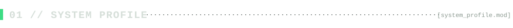</picture>

<picture><source media="(prefers-color-scheme: dark)" srcset="assets/generated/dark/profile.svg"><source media="(prefers-color-scheme: light)" srcset="assets/generated/light/profile.svg"></picture>

> **Senior Backend & API Architect** with nearly 5 years of production experience. I build the backend of multi-tenant SaaS platforms: the APIs, data model, access control and automation that keep large systems fast and safe to change. I have worked in Pakistan and remotely for an Australian startup.

<picture><source media="(prefers-color-scheme: dark)" srcset="assets/generated/dark/h-telemetry.svg"><source media="(prefers-color-scheme: light)" srcset="assets/generated/light/h-telemetry.svg">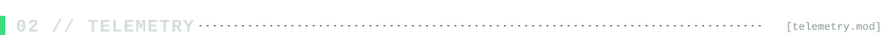</picture>

<picture><source media="(prefers-color-scheme: dark)" srcset="assets/generated/dark/telemetry.svg"><source media="(prefers-color-scheme: light)" srcset="assets/generated/light/telemetry.svg"></picture>

<picture><source media="(prefers-color-scheme: dark)" srcset="assets/generated/dark/h-stack.svg"><source media="(prefers-color-scheme: light)" srcset="assets/generated/light/h-stack.svg">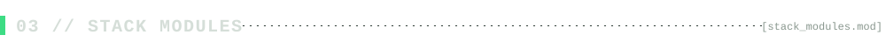</picture>

<picture><source media="(prefers-color-scheme: dark)" srcset="assets/generated/dark/stack.svg"><source media="(prefers-color-scheme: light)" srcset="assets/generated/light/stack.svg">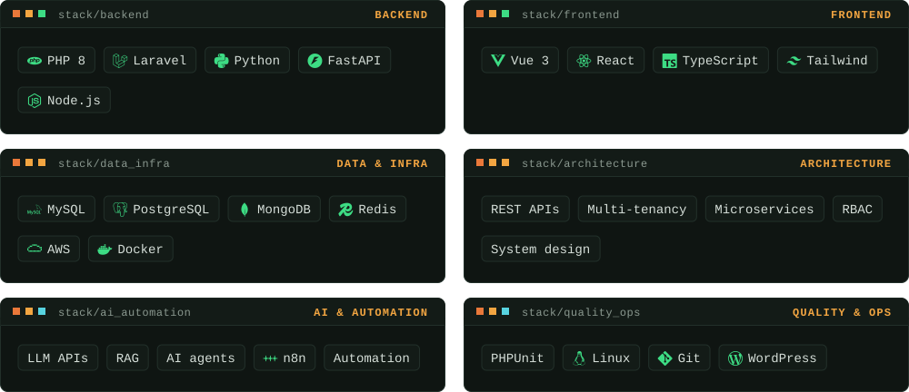</picture>

<picture><source media="(prefers-color-scheme: dark)" srcset="assets/generated/dark/h-work.svg"><source media="(prefers-color-scheme: light)" srcset="assets/generated/light/h-work.svg">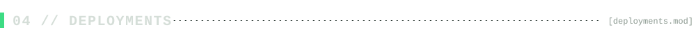</picture>

<picture><source media="(prefers-color-scheme: dark)" srcset="assets/generated/dark/work-mediatiz.svg"><source media="(prefers-color-scheme: light)" srcset="assets/generated/light/work-mediatiz.svg">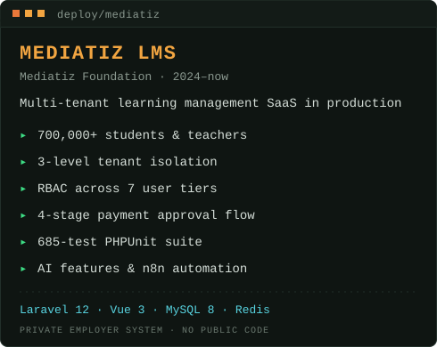</picture> <picture><source media="(prefers-color-scheme: dark)" srcset="assets/generated/dark/work-migrova.svg"><source media="(prefers-color-scheme: light)" srcset="assets/generated/light/work-migrova.svg">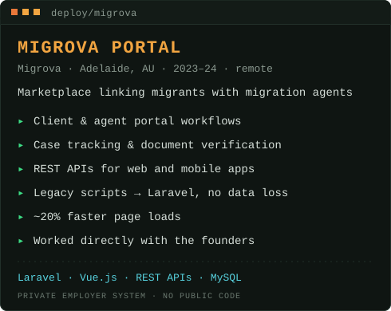</picture>

Employer systems are private. These cards summarise public CV facts only; no proprietary code, architecture or data is published.

<picture><source media="(prefers-color-scheme: dark)" srcset="assets/generated/dark/h-lab.svg"><source media="(prefers-color-scheme: light)" srcset="assets/generated/light/h-lab.svg">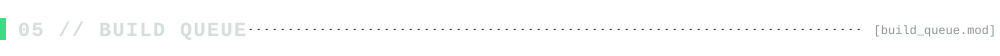</picture>

<picture><source media="(prefers-color-scheme: dark)" srcset="assets/generated/dark/lab.svg"><source media="(prefers-color-scheme: light)" srcset="assets/generated/light/lab.svg">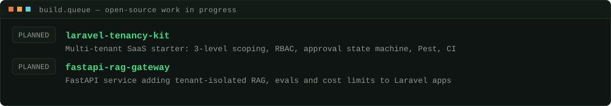</picture>

<picture><source media="(prefers-color-scheme: dark)" srcset="assets/generated/dark/h-activity.svg"><source media="(prefers-color-scheme: light)" srcset="assets/generated/light/h-activity.svg">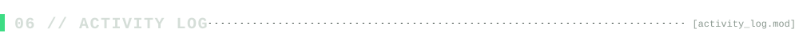</picture>

<picture><source media="(prefers-color-scheme: dark)" srcset="assets/generated/dark/activity.svg"><source media="(prefers-color-scheme: light)" srcset="assets/generated/light/activity.svg">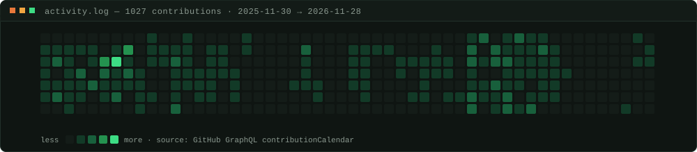</picture>

<picture><source media="(prefers-color-scheme: dark)" srcset="assets/generated/dark/h-interests.svg"><source media="(prefers-color-scheme: light)" srcset="assets/generated/light/h-interests.svg">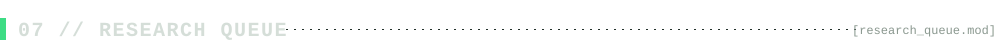</picture>

<picture><source media="(prefers-color-scheme: dark)" srcset="assets/generated/dark/interests.svg"><source media="(prefers-color-scheme: light)" srcset="assets/generated/light/interests.svg"></picture>

<picture><source media="(prefers-color-scheme: dark)" srcset="assets/generated/dark/h-contact.svg"><source media="(prefers-color-scheme: light)" srcset="assets/generated/light/h-contact.svg">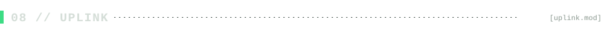</picture>

<a href="https://www.linkedin.com/in/nawsher-ali-saas-architect/"><picture><source media="(prefers-color-scheme: dark)" srcset="assets/generated/dark/btn-linkedin.svg"><source media="(prefers-color-scheme: light)" srcset="assets/generated/light/btn-linkedin.svg">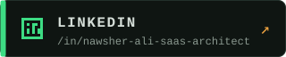</picture></a> <a href="mailto:nawsherali.edu@gmail.com"><picture><source media="(prefers-color-scheme: dark)" srcset="assets/generated/dark/btn-email.svg"><source media="(prefers-color-scheme: light)" srcset="assets/generated/light/btn-email.svg">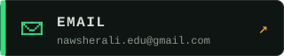</picture></a> <a href="https://github.com/NawsherAli"><picture><source media="(prefers-color-scheme: dark)" srcset="assets/generated/dark/btn-github.svg"><source media="(prefers-color-scheme: light)" srcset="assets/generated/light/btn-github.svg">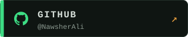</picture></a>

Open to senior backend / API / SaaS roles · remote (UK · EU · Gulf hours) or relocation

<picture><source media="(prefers-color-scheme: dark)" srcset="assets/generated/dark/footer.svg"><source media="(prefers-color-scheme: light)" srcset="assets/generated/light/footer.svg"></picture>

<a href="#top"><kbd>↑ TOP</kbd></a>

